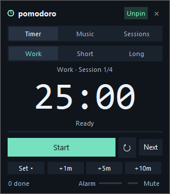
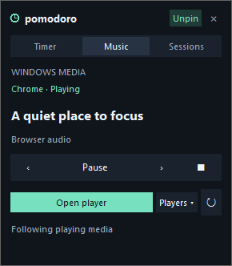

# Pomodoro Timer Widget

A small, always-on-top Pomodoro timer for Windows.



## Compact interface

- Graphite surfaces, phase-coloured accents, a large countdown, and a thin progress
  line. The default layout is about **290×332 pixels at 100% scaling**, versus the
  previous 402-pixel-tall layout; controls scale with Windows text settings.
- Segmented **Timer / Music / Sessions** navigation keeps secondary controls out
  of the timer's way. **Set ▾** contains the 25/15/5-minute presets; **↻** resets
  the current timer, and **Next** loads the next phase without starting it.
- Hover for control descriptions and shortcut hints. Tab moves between controls;
  Enter activates a focused button. Alarm volume and mute sit in the slim footer.
- Work, short-break, and long-break phases use mint, blue, and lilac accents.
  Completion gently pulses the border/countdown rather than flashing a large panel.
- On the first launch after this UI upgrade, old window dimensions are compacted
  once while keeping the saved position, timer, plan, and audio settings. The UI
  uses standard tkinter; optional Windows media detection is described below.

## Run manually

Option 1 - Standalone executable (no Python needed):

- Double-click `dist\PomodoroTimer.exe`
- Or from a terminal: `.\dist\PomodoroTimer.exe`

Option 2 - From source (Python 3 with tkinter, included with standard Windows Python installs):

- For track detection and targeted controls: `python -m pip install -r requirements.txt`
- `python pomodoro.py`
- Or double-click `run.bat`

## Start automatically with Windows

To launch the widget every time you log in to Windows:

### Method A - Startup folder (recommended, simplest)

1. Press `Win + R`, type `shell:startup`, press Enter. This opens your personal Startup folder.
2. Create a shortcut there:
   - Right-click in the folder -> New -> Shortcut.
   - Target: full path to the executable, e.g. `G:\Documents\Projects\Pomodoro_widget\dist\PomodoroTimer.exe`
     (or to the launcher: `G:\Documents\Projects\Pomodoro_widget\run.bat`)
   - Name it `Pomodoro Timer` and finish.
3. (Optional) Right-click the shortcut -> Properties -> set "Run" to "Minimized" is not needed; the widget is borderless. You can also set a hotkey in the Shortcut key field.
4. Log out and back in (or restart) to verify the widget appears.

### Method B - Task Scheduler (more control)

1. Open Task Scheduler (`taskschd.msc`).
2. Create Task -> General tab: name it `Pomodoro Timer`, choose "Run only when user is logged on".
3. Triggers tab -> New -> "At log on" (optionally delay by 10 seconds).
4. Actions tab -> New -> "Start a program" -> Program: `G:\Documents\Projects\Pomodoro_widget\dist\PomodoroTimer.exe`.
5. Conditions tab -> uncheck "Start the task only if the computer is on AC power" if on a laptop.
6. Save and test by running the task manually.

### Method C - Registry (advanced)

Add a string value under `HKCU\Software\Microsoft\Windows\CurrentVersion\Run`:

- Name: `PomodoroTimer`
- Value: `"G:\Documents\Projects\Pomodoro_widget\dist\PomodoroTimer.exe"`

You can do this via PowerShell:

```powershell
Set-ItemProperty -Path "HKCU:\Software\Microsoft\Windows\CurrentVersion\Run" `
  -Name "PomodoroTimer" `
  -Value '"G:\Documents\Projects\Pomodoro_widget\dist\PomodoroTimer.exe"'
```

To remove it later:

```powershell
Remove-ItemProperty -Path "HKCU:\Software\Microsoft\Windows\CurrentVersion\Run" -Name "PomodoroTimer"
```

## Features

- Stays on top of all windows (toggle with the "Pin"/"Unpin" button).
- Borderless, draggable widget.
- A taskbar/Alt+Tab entry makes the widget easy to find. Launching it again reveals
  the existing timer instead of creating a duplicate or resetting its countdown.
- Window size fits all three views at the current display scaling; music controls
  share a compact playback strip. Restoring or dragging the widget
  keeps it within a monitor's usable area, clear of the taskbar.
- Start / Pause / Reset.
- Work sessions, short breaks, and long breaks with a persistent completed-session
  count and configurable plan in the **Sessions** tab.
- Status feedback (such as `Set 5m`, `+10m`, `Paused`, and `Done!`) remains visible
  through countdown refreshes until the next action changes it.
- Extend the running timer: `+1m`, `+5m`, `+10m` (or `+`/`-` keys).
- Quick presets: 25m / 15m / 5m in the **Set ▾** menu.
- Time adjustments preserve elapsed time and clamp at zero remaining / one year
  total. Removing all remaining time completes immediately, even while paused;
  repeated subtraction does not repeat the alert.
- Sound + flash when the timer completes (volume slider + mute in the widget).
- When another window has focus, the widget is **20% opaque / 80% transparent**, so
  the window underneath shows through. Clicking or focusing the widget makes it
  **100% opaque**. This applies both pinned and unpinned. Focus loss updates at
  the next UI idle cycle, with a 100 ms Windows foreground check as a fallback;
  there is no two-second fade delay. Startup does not steal keyboard focus.
- Remembers last state (phase, session count/plan, duration, remaining time, volume,
  mute, pin, position) between runs. Reopening never starts a countdown automatically.
- Volume-slider saves are debounced by 250 ms; closing the app flushes pending
  changes. Settings are written to a temporary sibling file and atomically
  replaced, so a failed write does not truncate the previous settings.
- Music tab detects Windows media sessions from browsers, Spotify, and other
  compatible apps; shows the track/artist and provides targeted playback and
  **Open player** controls. No playlist links or account login are needed.
- Keyboard `+`/`-` adjust by 10 minutes.

## Work sessions and breaks

The default cycle is **25 minutes work → 5 minutes short break**, with a
**15-minute long break after every four completed work sessions**.

- The **Timer** tab shows the current phase, session number, and completed work
  count. Use **Work**, **Short**, or **Long** to choose a phase while stopped or
  paused. These buttons load the configured duration, but do not start it.
- When a timer finishes, it alerts and waits at zero. **Start next** (or `Space` /
  the global Start/Pause shortcut) loads and starts the next work/break phase.
  **Next** loads the next phase but leaves it paused. No phase auto-starts.
- Only completed work phases increase the count. Breaks and skipped phases do
  not. Extending a just-finished work timer does not count that same session twice.
- **↻ Reset** restarts the current phase's timer (including any duration adjustment)
  without erasing the completed-session history. Presets adjust only the current
  timer, not the saved plan. Pause before changing phases.
- In **Sessions**, edit durations and the long-break interval, then click
  **Save plan**. Changes apply to future phases, not the timer already running.
  **Reset count** clears the history/cycle without interrupting a countdown.
- Phase, count, plan settings, and paused remaining time survive restarts. Old
  settings files retain their existing timer and get the default work/break plan;
  previously finished timers are not retroactively credited as work sessions.

| Plan setting | Default | Allowed range |
| --- | --- | --- |
| Work | 25 minutes | 1–240 minutes |
| Short break | 5 minutes | 1–120 minutes |
| Long break | 15 minutes | 1–240 minutes |
| Sessions per long break | 4 | 1–24 sessions |

## Currently playing media

Open **Music** to detect Windows media sessions. Discovery runs in a background
thread and starts only when this view is first opened; the timer stays responsive.



*Panel example with illustrative track metadata.*

- **Play/Pause**, **Previous**, **Next**, and **Stop** control the displayed player.
  Unsupported actions are disabled rather than sent to a different app.
- **Players ▾** lets you select a session, or **Follow playing media** automatically.
  Playing sessions take priority over paused ones. The track, artist, playback
  state, and source app refresh about once a second.
- **Open player** reveals/restores the source app or browser window, including
  hidden tray-player main windows when identifiable. Registered packaged apps can
  also be launched if their window is unavailable. This does not open a playlist
  link or intentionally start a second desktop player instance. With multiple
  browser windows, a title match is preferred; switching browser tabs is not
  guaranteed. If Windows blocks activation or no window can be identified, use
  that app's taskbar/tray icon.
- **↻** refreshes sessions. Closed players disappear automatically. Track data is
  kept only in memory, never written to timer settings or sent to a server.
- If an app does not publish a Windows media session, or media support is missing,
  the panel explicitly switches to **System media keys**. Playback buttons then
  send normal Windows media keys; metadata and **Open player** are unavailable.
  Not every legacy app/browser site supports metadata or every control.

Native detection requires **Windows 10 version 1809 or newer** and the optional
Python/WinRT packages in `requirements.txt` (Python 3.9–3.14). The standalone
executable bundles these packages, so no Python installation is needed. The timer
and generic media keys still work without them. Use `--no-media` to disable native
discovery entirely. Alarm volume/mute controls affect the timer, not your music.

For read-only diagnostics of the packaged media backend (no playback, launch,
track titles, or settings changes):

```powershell
.\dist\PomodoroTimer.exe --media-check "$env:TEMP\pomodoro-media-check.json"
Get-Content "$env:TEMP\pomodoro-media-check.json"
```

## Keyboard shortcuts

- `Space` - Start/Pause
- `R` - Reset
- `+` / `-` - Add/remove 10 minutes
- `Esc` - Restore the window's default size/position and make it opaque, without
  resetting the timer or audio settings (while the widget has keyboard focus).

Plain shortcuts apply only inside the widget and do not intercept text entry.
The following global shortcuts work while another application is focused:

| Shortcut | Action |
| --- | --- |
| `Ctrl+Alt+Space` | Start/Pause |
| `Ctrl+Alt+R` | Reset |
| `Ctrl+Alt+=` / `Ctrl+Alt+Numpad +` | Add 10 minutes |
| `Ctrl+Alt+-` / `Ctrl+Alt+Numpad -` | Remove 10 minutes |
| `Ctrl+Alt+P` | Show/reposition the widget |

Global shortcuts are released on exit. If another application owns a shortcut,
the widget reports the conflict and keeps its remaining controls working.
To disable global shortcuts, add `--no-global-hotkeys` when launching the Python
script or executable. Tests mock registration; executable smoke tests use this
flag so they do not capture your keyboard shortcuts.

An optional native-backend test briefly registers available shortcuts and posts
an internal Windows message (it does not simulate typing in other applications):

```powershell
$env:POMODORO_TEST_HOTKEYS = '1'
python -m unittest tests.test_windows_integration.NativeHotkeyTests -v
Remove-Item Env:\POMODORO_TEST_HOTKEYS
```

## Testing

Run the unit tests:

```powershell
python -m unittest discover -s tests -v
```

Use `python -B -m unittest discover -s tests -v` to avoid creating Python bytecode
caches during tests. Generated caches and build intermediates are ignored by Git;
the standalone `dist\PomodoroTimer.exe` is intentionally versioned.

### Clean generated files

```powershell
python -B tools\clean_generated.py --dry-run
python -B tools\clean_generated.py
```

The tool removes only known cache/build files and empty generated directories.
It preserves `dist`, settings, source, unfamiliar files, and custom build specs;
it does not follow directory links/junctions. Add `--include-spec` only if you also
want to remove the generated `PomodoroTimer.spec` (not a customized version).

To rebuild the executable (requires the optional PyInstaller development tool):

```powershell
python -m pip install pyinstaller
python -m pip install -r requirements.txt
python -m PyInstaller --onefile --windowed --name PomodoroTimer --noconfirm --collect-submodules winrt pomodoro.py
```

Tests require Windows, Python with tkinter, and an interactive desktop. Each test
uses a temporary settings file; tests never read or overwrite your saved timer
settings. Media playback is not triggered by the tests.
Unit tests mock players and playback/launch actions. To run the optional native
discovery test, set `POMODORO_TEST_MEDIA=1`; it reads sessions only and does not
send controls or launch applications. Packaged smoke tests also verify the
bundled WinRT backend with the read-only diagnostics command.

## Packaging

The app version starts at `0.1.0` and is defined once in `pomodoro.py`
(`APP_VERSION`), then surfaced through the CLI:

```powershell
.\dist\PomodoroTimer.exe --version
```

### Build the Windows installer (MSI)

The Windows installer is built with the [WiX Toolset](https://wixtoolset.org/):

```powershell
python -m pip install -r requirements.txt
python -m PyInstaller --onefile --windowed --name PomodoroTimer --noconfirm --collect-submodules winrt pomodoro.py
wix candle installer\PomodoroTimer.wxs -o installer\PomodoroTimer.wixobj
wix light installer\PomodoroTimer.wixobj -out Output\PomodoroTimer-Setup-0.1.0.msi
```

The build produces `Output\PomodoroTimer-Setup-0.1.0.msi`.

The installer:

- Installs the standalone executable to `C:\Program Files\Pomodoro\PomodoroTimer.exe`.
- Creates a Start Menu shortcut.
- Adds an optional run-at-logon entry (registry component gated on the `RUNATLOGON`
  property, off by default).
- Generates a standard MSI uninstaller that removes the executable, shortcut, and
  optional autostart entry.

### Installer behaviour checklist

- A normal install completes and the widget starts from the Start Menu shortcut.
- The optional run-at-logon entry is off by default and can be enabled.
- The generated uninstaller cleanly removes the executable, shortcut, and any
  enabled autostart entry.

## Notes

- Use the taskbar or Alt+Tab to find the borderless widget; use `X` to close it.
- Only one app instance runs per Windows session and settings-file path. Relaunch
  requests are sent to the existing window. `--reset-state` on a second launch
  only reveals the running app; close it first if you intend to reset settings.
- To stop autostart, remove the shortcut/task/registry entry you created above.

## Troubleshooting: app runs but no window appears

Saved settings live in `%USERPROFILE%\.pomodoro_state.json`. Older versions
could save an invisible `1x1` window, especially after running the old tests.
The fixed version automatically repairs tiny, malformed, oversized, and off-screen
window geometry and opens within a usable monitor area. Valid timer and audio
settings are kept; hidden windows no longer overwrite the last valid geometry.
Older saved sizes are expanded when needed to fit the controls. The minimum size
is measured from the UI, rather than fixed at 290×300. Monitor work areas exclude
taskbars and docked toolbars; negative-coordinate secondary monitors are supported.
On unusually small work areas that cannot fit the entire UI, the window is capped
to the available space to keep the header and close button reachable.
Invalid JSON, non-object settings, and invalid field types no longer prevent
startup. Invalid fields fall back to defaults; remaining time and volume are
bounded to valid ranges. Saved durations outside 1 second–1 year use the default
25 minutes. Timers reopen paused; completed timers remain at zero.

Both the Python source and rebuilt `dist\PomodoroTimer.exe` include this recovery.

### Reset saved settings safely

Close existing copies of the widget first. If you want to reset all preferences
(including a volume/mute setting left by the old tests), run either:

```powershell
python pomodoro.py --reset-state
# Or, without Python:
.\dist\PomodoroTimer.exe --reset-state
```

The original settings are moved to a timestamped
`%USERPROFILE%\.pomodoro_state.json.backup-*` file before opening defaults.
If the backup fails, resetting stops and the original file is left untouched.
To restore a backup, close the app and copy that backup to
`%USERPROFILE%\.pomodoro_state.json`.

### Packaged executable smoke test

This opt-in test launches a temporary copy of the executable with isolated
settings, checks 20%/100% opacity while switching real foreground windows and
recovery from `1x1`, off-screen, oversized,
or malformed settings, verifies taskbar/Alt+Tab styles, duplicate-launch behavior,
work/break plan persistence and backward compatibility,
taskbar-safe bounds and reset backups, then closes it. It does not launch Spotify
or change your own settings.
The foreground-switching check temporarily activates test windows where Windows
permits it; it is skipped when the session's foreground policy blocks activation.
The inactive-opacity check separately reads the executable's native alpha value.

```powershell
$env:POMODORO_TEST_EXE = (Resolve-Path .\dist\PomodoroTimer.exe).Path
python -m unittest tests.test_executable -v
Remove-Item Env:\POMODORO_TEST_EXE
```

## License

Released under the [MIT License](LICENSE). Copyright (c) 2026 Rajat Gade.
